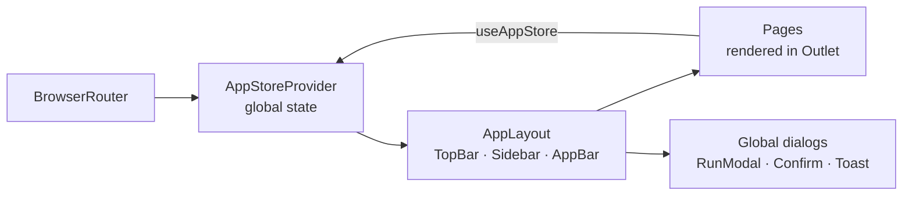

# Scheduled SQL Report & Email Automation System

A web application for IT and operations teams to schedule SQL reports, generate them as Excel, PDF, CSV or JSON files, and deliver them automatically by email, with full monitoring of every run.


**[▶ Live demo](https://aliamar93.github.io/Email-Automation-System/)**


---

## About the project

In many companies, especially in logistics, warehousing and ERP environments, employees still run the same database queries by hand every day, copy the results into Excel and send them by email. This is slow, easy to forget and hard to audit.

This application replaces that routine with one central place where a user defines a SQL query once, chooses the output format, recipients and schedule, and then monitors every execution: what ran, when, how many rows it returned, whether the email was delivered, and why something failed.

> **Project status:** This repository contains the **frontend**. All data comes from mock data in `src/mocks/`, and the scheduler, query execution and email delivery are simulated in the browser. Connecting a real backend API is the next step (see [Roadmap](#roadmap)).

## Features

**Dashboard.** KPI cards (total, active and disabled reports, failures in the last 24 hours, reports sent today, 7-day success rate), a chart of successful versus failed runs over the last 7 days, a system health panel (scheduler, SMTP relay, database connections, queue depth), upcoming runs, recent failures with one-click retry, and a recent activity feed.

**Scheduled reports.** A searchable, sortable table with filters for status, output format, schedule type, owner and date range. Includes pagination, bulk selection and actions, an enable/disable toggle, and run, view, edit, duplicate and delete actions with confirmation dialogs.

**Report wizard (create and edit).** A step-by-step form covering:
- General information and status
- Database connection and SQL query
- Query parameters (`@StartDate`, `@EndDate`, …)
- Output: Excel, PDF, CSV or JSON, file name pattern, frozen header row, auto-fit columns, company logo and page numbers
- Email recipients, subject and body, using reusable templates with variables such as `{{Date}}`, `{{ReportTitle}}` and `{{RowCount}}`
- Schedule: run once, every X minutes, hourly, daily, weekly, monthly or custom, with timezone and start/end dates
- Failure handling: retries, retry interval, administrator notification, and a rule for empty results

Reports can be saved as a draft, activated, or test-run before activation.

**SQL editor with safety checks.** Syntax highlighting, line numbers and automatic parameter detection. Validation only accepts read-only `SELECT` queries and blocks write statements (`INSERT`, `UPDATE`, `DELETE`, `DROP`, `TRUNCATE`, `ALTER`, `EXEC`, `MERGE`, `GRANT`). A preview shows the first 5 result rows together with row count, column count and execution time.

**Run now.** A progress dialog walks through each stage (connecting to the database, running the query, generating Excel and PDF, sending the email) with a live log. A test run changes nothing, while a real run creates an execution record and an audit log entry.

**Report details.** The full configuration, recipients, an email preview, and that report's execution history, with options to re-run, re-send, and download the generated files and logs.

**Execution history.** Every scheduled, manual and retried run, with filters by report, status and trigger type, a log viewer, retry for failed runs, and CSV export.

**Database connections.** Manage connections to SQL Server, PostgreSQL, Oracle, Azure SQL and Microsoft Fabric, including host, port, credentials, SSL/TLS, a read-only flag and a connection test.

**Email and report templates.** Create, edit, duplicate and test email templates. Start a new report from a ready-made template (Warehouse Orders, Stock On Hand, Invoice Ageing, Carrier Performance) with an SQL preview.

**Settings.** General settings, SMTP configuration, security rules (SELECT-only queries, blocked write statements, encrypted credentials, mandatory SSL/TLS), data retention and user roles (Administrator, Report Creator, Report Viewer).

**Audit logs.** Every create, update, delete and execute action is recorded with user, timestamp, entity and source IP, and can be searched, filtered and exported.

**Across the whole app.** Global search over reports, connections, templates and executions; notifications; toast messages; confirmation dialogs; and a responsive layout with a collapsible sidebar on mobile.

## Screenshots

<table>
  <tr>
    <td width="50%"><br><sub>Scheduled reports with filters and quick actions</sub></td>
    <td width="50%"><br><sub>SQL editor with validation and result preview</sub></td>
  </tr>
  <tr>
    <td width="50%"><br><sub>Write statements such as DELETE are blocked</sub></td>
    <td width="50%"><br><sub>Manual run with step-by-step progress and live log</sub></td>
  </tr>
  <tr>
    <td width="50%"><br><sub>Execution history with filters and CSV export</sub></td>
    <td width="50%" align="center"><br><sub>Responsive mobile layout</sub></td>
  </tr>
</table>

## Tech stack

| Area | Technology |
|---|---|
| UI library | React |
| Language | TypeScript |
| Build tool and dev server | Vite |
| Styling | Tailwind CSS |
| Routing | React Router |
| Icons | lucide-react |
| State management | React Context with a custom `useAppStore` hook |
| Code quality | ESLint |

## Getting started

**Requirements:** [Node.js](https://nodejs.org/) 20 or newer (LTS recommended).

```bash
git clone https://github.com/YOUR-USERNAME/report-automation.git
cd report-automation
npm install
npm run dev
```

Then open http://localhost:5173 in your browser.

| Command | What it does |
|---|---|
| `npm run dev` | Starts the development server with hot reload |
| `npm run build` | Type-checks the project and creates a production build in `dist/` |
| `npm run preview` | Serves the production build locally |
| `npm run lint` | Checks the code with ESLint |

**No installation needed:** `docs/index.html` is a standalone build of the whole app in a single file. Open it in any browser to try it offline. It is also what the live demo serves.

## Project structure

```
src/
├── App.tsx              # Route definitions
├── components/
│   ├── layout/          # AppLayout, TopBar, Sidebar, AppBar
│   └── UI/              # Reusable components: Dropdown, Confirm, RunModal, Toast, …
├── context/             # AppStoreContext and AppStoreProvider (global state)
├── hooks/               # useAppStore
├── features/            # One folder per page
│   ├── dashboard/
│   ├── reports/         # List, details, create/edit form
│   ├── execution/
│   ├── database/
│   ├── templates/       # Email and report templates
│   ├── settings/
│   ├── audit/
│   └── not-found/
├── mocks/               # Seed data: reports, executions, connections, templates, …
└── types/               # Shared TypeScript types
```

## How it works



- **Routing.** All pages share one `AppLayout` (top bar, sidebar, page header) and are rendered through React Router's `<Outlet />`.
- **State.** `AppStoreProvider` holds all application data (reports, executions, connections, templates, notifications, settings and the audit log) and exposes it through the `useAppStore()` hook. Shared actions such as `runReport`, `finishRun`, `toast` and `confirm` live in one place, and every change also writes an audit log entry.
- **Global dialogs.** The run dialog, confirmation dialog and toast messages are rendered once in the layout and controlled through the store, so any page can open them.
- **Typed throughout.** Reports, executions, connections and the other entities are defined as shared TypeScript types, which keeps the mock data, the store and the pages consistent.

| Route | Page |
|---|---|
| `/` | Dashboard |
| `/reports` | Scheduled reports |
| `/reports/new`, `/reports/:id/edit` | Report wizard |
| `/reports/:id` | Report details |
| `/executions` | Execution history |
| `/connections` | Database connections |
| `/email-templates` | Email templates |
| `/report-templates` | Report templates |
| `/settings` | Settings |
| `/audit` | Audit logs |

## Roadmap

- [ ] Backend API that replaces the mock data, with real SQL execution, a job scheduler and SMTP delivery
- [ ] Login and role-based permissions
- [ ] Approval workflow before a new report goes live
- [ ] Password-protected attachments
- [ ] Webhooks and a public API
- [ ] Automatic retention and cleanup of generated files
- [ ] Unit and component tests (Vitest and React Testing Library)

## What I learned

- Structuring a multi-page React application by feature, with a shared layout and nested routes
- Designing typed global state with React Context and a custom hook, instead of passing props through many levels
- Building reusable, accessible UI components (dialogs, dropdowns, tables with sorting, filtering and pagination)
- Building a fully responsive interface with Tailwind CSS
- Thinking about security from the start, for example by allowing only read-only SQL queries

## Author

**YOUR NAME**
[LinkedIn](https://www.linkedin.com/in/YOUR-PROFILE) · [Email](mailto:YOUR-EMAIL) · [GitHub](https://github.com/YOUR-USERNAME)
